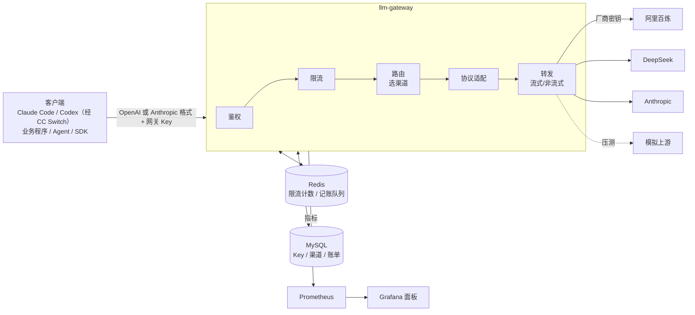
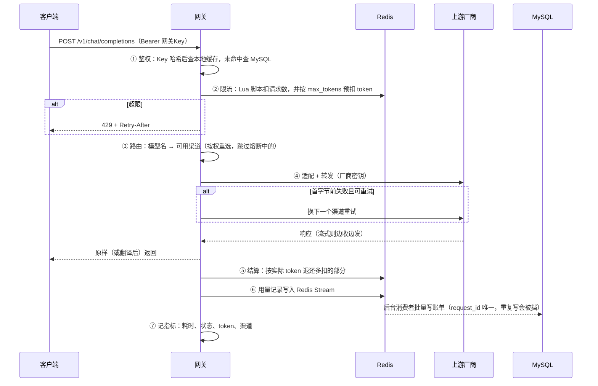

# llm-gateway 总体设计

> 先看第 1、2、3 节就能明白整体；第 4 节按功能逐个看，做到哪个看哪个。

## 1. 一句话和边界

**一句话：** 公司里的程序和 Agent 不直接连模型厂商，都连这个网关。网关核对身份、控制用量、选厂商、转发、出故障自动换、记账，并把这一切画在面板上。

**定位：团队版 CC Switch。** CC Switch 解决“一个人怎么方便地切换供应商”；本网关解决“一个团队怎么安全、可控地使用 AI 编程工具”。公司给 50 个开发者开通 Claude Code、Codex：厂商密钥不发给个人，每人一个网关 Key；每人有额度；每人花了多少钱一目了然；出了问题能查记录。开发者只需在 CC Switch 里加一个供应商，地址填公司网关，Key 填自己的。

**演示：** 打开 Claude Code 让它写代码，Grafana 面板上实时看到这个开发者的 token 和花费在涨；把他的额度调低，下一次请求就被限流；关掉一个上游，请求自动切到另一个，开发者无感。

**做：** 数据面——每个请求进来怎么处理。

**不做：**
- 配置中心、配置发布（本项目只关注数据面）。
- RAG、桌面端、聊天界面。
- 多机房、多活（单机 + Redis + MySQL 足够讲清楚原理）。

## 2. 整体架构



**大白话：** 请求像过安检，依次经过 5 道关：核对身份 → 看有没有超量 → 决定找哪家厂商 → 把格式翻译成那家能懂的 → 送过去并把回答带回来。Redis 放“要快”的东西（计数），MySQL 放“要稳”的东西（Key、账单）。

## 3. 一个请求的全过程



每一步失败怎么办，在第 4 节对应功能里讲。

## 4. 各功能设计

### 功能 1：转发 + 模拟上游（已完成）

要点：两种超时分开；上游错误原样透传（502 连不上、504 超时）；客户端 Key 不转发、不进日志；模拟上游用 `model` 名触发故障。

### 功能 2：可观测面板

**解决：** 网关慢了、错了、钱花多了，要一眼看出来；后面每个功能的效果也要有数字。

**指标设计**（Micrometer 采集，Prometheus 抓取，Grafana 画图）：

| 指标 | 类型 | 标签 | 回答什么问题 |
| --- | --- | --- | --- |
| `gateway_requests_total` | 计数 | key, model, channel, status | 每秒多少请求、错误率多少 |
| `gateway_request_duration_seconds` | 直方图 | model, channel | P50 / P95 / P99 延迟 |
| `gateway_overhead_seconds` | 直方图 | — | 网关自己花了多久（总耗时减去等上游的时间） |
| `gateway_tokens_total` | 计数 | key, model, type(prompt/completion) | 谁用了多少 token |
| `gateway_cost_total` | 计数 | key, model | 花了多少钱 |
| `gateway_ratelimit_rejected_total` | 计数 | key, dimension(rpm/tpm) | 限流拦了多少 |
| `gateway_upstream_failover_total` | 计数 | from, to, reason | 故障切换了多少次 |
| `gateway_circuit_state` | 仪表 | channel | 每个渠道的熔断状态 |

**为什么单独有“网关自身耗时”：** 总耗时大部分是在等模型，看不出网关本身好不好。压测时最该看的是这一项。

**坑：** 标签里放 key 要小心，Key 多了时间序列会爆（高基数问题）。只放 key 的 ID，不放明文；Key 数量很大时改为只统计前 N 名。

**已实现（功能 2）：** `gateway_requests_total{model,status,outcome}`、`gateway_request_duration_seconds`、`gateway_upstream_duration_seconds`、`gateway_overhead_seconds`、`gateway_tokens_total{model,type}`。表里其余的标签和指标随对应功能加入：key 随鉴权（3），限流拒绝随限流（4），channel、故障切换、熔断随多上游（6），花费随记账（8）。

- `outcome` 比状态码更直接：success / upstream_error（上游 4xx、5xx 透传）/ upstream_timeout（504）/ upstream_unavailable（502）。
- 读 `model` 和响应里的 `usage` 用 Jackson 流式解析，只看顶层字段，命中就停，不把整个请求体解析成树。
- `model` 来自客户端，可以乱填。用 `MeterFilter.maximumAllowableTags` 限制最多 50 个不同值，超出的不再生成时间序列，转发不受影响。有了模型配置（功能 6）后改为只认配置里的模型。
- 直方图桶范围自己定：总耗时和上游耗时 5ms ~ 5 分钟（模型生成可能超过默认上限 30 秒），网关自身耗时 50µs ~ 1 秒（默认从 1ms 起，看不出差别）。
- 基线压测数字见 README“性能基线”。

**部署：** Prometheus、Grafana 用 Docker Compose 一键起，面板 JSON 放仓库。

### 功能 3：API Key 鉴权

**解决：** 只给认证过的人用；每人一个网关 Key，厂商密钥不外发。

**Key 格式：** `sk-gw-` + 32 位随机串。只在创建时显示一次。

**表 `api_key`：**

| 字段 | 说明 |
| --- | --- |
| id | 主键 |
| key_hash | Key 的 SHA-256，唯一索引。**库里不存明文** |
| key_prefix | 前 8 位，方便人认出是哪个 Key |
| name / owner | 备注、归属 |
| status | active / disabled |
| rpm_limit / tpm_limit | 每分钟请求数、每分钟 token 数上限 |
| allowed_models | 允许用的模型，空表示全部 |
| created_at / expires_at | |

**流程：** 取出 `Authorization` → 算哈希 → 查本地缓存（Caffeine，30 秒过期）→ 未命中查 MySQL → 检查状态、过期、模型权限。

**取舍：**
- 为什么存哈希不存明文：数据库泄露了，攻击者也拿不到能用的 Key。为什么用 SHA-256 不用 BCrypt：Key 本身是 32 位高熵随机串，不怕暴力破解；BCrypt 每次几十毫秒，每个请求都算会拖慢网关。
- 为什么本地缓存：每个请求都查库，数据库扛不住。代价是禁用一个 Key 最多 30 秒后才生效。

**管理接口：** `POST /admin/keys` 创建、`PATCH /admin/keys/{id}` 禁用或改额度，用单独的管理员令牌保护。

### 功能 4：限流（按请求数 + 按 token）

**解决：** 防止一个人把额度用光、把账单打爆。

**两个维度：**
- RPM：每分钟请求数。
- TPM：每分钟 token 数。这是大模型特有的——一个请求可能 10 个 token，也可能 10 万个。

**算法：令牌桶，计数放 Redis，用 Lua 脚本。**

| 选择 | 为什么 |
| --- | --- |
| 令牌桶，不用固定窗口 | 固定窗口在窗口交界处可能放过两倍流量；令牌桶允许适度突发，长期速率稳定 |
| 放 Redis，不放本机内存 | 网关多台部署时共享一个计数，否则总量是 N 倍 |
| Lua 脚本 | “读剩余、算补充、扣减、写回”必须一步完成，否则并发下会超扣 |

**token 维度的难点：请求发出前不知道会用多少 token。**
做法是 **预扣 + 结算**：
1. 请求前按 `估算输入 token + max_tokens` 预扣（没传 `max_tokens` 用默认上限）。
2. 响应回来按实际 `usage` 结算，多扣的退回。
3. 流式中途断开：按已收到的内容估算，结算后退回。

**Redis 挂了怎么办：** 降级为本机内存限流（按“总额度 ÷ 实例数”估算），并报警。选择“降级放行”而不是“全部拒绝”，因为网关不可用的代价比短时间超量大。这是一个取舍：如果业务对超量零容忍，应改为拒绝。

**返回：** 429，带 `Retry-After` 和 `x-ratelimit-remaining-*` 响应头。

→ 抽成共用组件（见第 6 节）。

### 功能 5：SSE 流式转发

**解决：** 大模型一个字一个字地吐，客户端要边收边显示，不能等全部生成完。

**SSE 是什么：** 一种 HTTP 响应格式，服务端持续往回写 `data: ...\n\n`，最后 `data: [DONE]`。

**做法：** 上游返回流，网关读一块转一块（Spring MVC 用 `StreamingResponseBody`，跑在虚拟线程上）。

**要处理的事：**

| 情况 | 做法 |
| --- | --- |
| 拿 token 用量 | 请求里加 `stream_options.include_usage=true`，最后一块带 usage；上游不支持就按字数估算 |
| 客户端中途关掉 | 写失败时立刻关闭上游连接，不然还在继续花钱 |
| 上游长时间不吐字 | “两块之间最长间隔”超时，和总超时分开 |
| 已经吐了一半上游断了 | **不能再重试**（客户端已经收到半截），在流里发一个错误事件后结束 |

### 功能 6：多上游——协议适配、加权负载、故障切换、熔断

**概念：**
- **模型（model）**：客户端要的东西，比如 `qwen-plus`。
- **渠道（channel）**：能提供这个模型的一个具体来源，比如“百炼账号 A”“百炼账号 B”“某中转站”。

**表 `channel`：** id、provider（openai / anthropic …）、base_url、api_key（加密存储）、models（支持的模型列表）、weight（权重）、status、priority。

**协议适配：** 定义接口 `ProviderAdapter`，每家厂商一个实现：把 OpenAI 格式的请求翻成厂商格式，把响应（含流式）翻回来。新增厂商只加一个类。先做 OpenAI 兼容（直通）和 Anthropic 两家。

**选渠道：** 同模型、同优先级的渠道里按权重随机；跳过熔断中的渠道；高优先级全部不可用才用低优先级。

**故障切换规则（哪些能重试）：**

| 错误 | 换渠道重试？ | 原因 |
| --- | --- | --- |
| 连不上、连接超时 | 是 | 请求根本没到上游 |
| 429、5xx，且还没收到任何响应内容 | 是 | 换一家通常能成 |
| 400（参数错）、401（密钥错） | 否 | 换谁都一样错（401 应把渠道标为不可用并报警） |
| 已经开始返回内容 | 否 | 客户端已收到一半 |

最多重试 2 次，带退避；重试也计入限流。

**熔断（每个渠道一个）：** 关闭 → 最近 N 次失败率超过阈值 → 打开（直接跳过这个渠道）→ 过一段时间 → 半开（放少量请求试探）→ 成功则关闭，失败再打开。

→ 熔断、重试抽成共用组件。

### 功能 7：Claude Code 接入（Anthropic 格式入口）——项目亮点

**解决：** Claude Code 只会说 Anthropic 的 Messages 格式（`POST /v1/messages`），而团队买的可能是 DeepSeek、通义等。网关要能接住 Claude Code 的请求，翻译后发给任意上游，再把回答翻译回去。

**开发者怎么接：** CC Switch 里新建供应商，地址填 `http://网关地址`，Key 填自己的网关 Key（Claude Code 通过 `ANTHROPIC_BASE_URL`、`ANTHROPIC_AUTH_TOKEN` 读取）。

**模型映射：** Claude Code 会请求 `claude-sonnet-…` 这类名字。表 `model_alias` 把它映射到团队实际用的模型（如 `claude-sonnet-*` → `deepseek-v4-pro`），可按 Key 配置。

**两条路：**

| 上游 | 做法 |
| --- | --- |
| 本身支持 Anthropic 格式（如 DeepSeek 提供的 Anthropic 兼容地址） | 直通，不翻译，只做鉴权、限流、记账 |
| 只支持 OpenAI 格式 | 双向翻译 |

**翻译要对上的东西（难点在这里）：**

| Anthropic | OpenAI |
| --- | --- |
| 顶层 `system` | 第一条 `role: system` 消息 |
| 内容块 `text` | `content` 字符串 |
| `tool_use`（助手要调工具） | 助手消息里的 `tool_calls` |
| `tool_result`（工具结果） | `role: tool` 消息，用 `tool_call_id` 对应 |
| `tools[].input_schema` | `tools[].function.parameters` |
| `stop_reason`：`end_turn` / `tool_use` / `max_tokens` | `finish_reason`：`stop` / `tool_calls` / `length` |

**流式翻译：** OpenAI 的流是一串“增量”；Anthropic 的流是有结构的事件：`message_start` → 每个内容块 `content_block_start` / `content_block_delta` / `content_block_stop` → `message_delta`（带 stop_reason 和用量）→ `message_stop`。网关要维护一个小状态机：当前是文字块还是工具块、第几个工具调用、参数 JSON 拼到哪了。

**坑：**
- 工具调用的参数是一段 JSON 分成很多小块流过来的，不能在中途解析，要原样按块转发（Anthropic 用 `input_json_delta`）。
- 一次回答里可能有多个工具调用，OpenAI 用 `index` 区分，要正确映射成多个内容块。
- Claude Code 还会调用 `/v1/messages/count_tokens` 估算长度，要提供（可用估算值）。
- 思考内容（thinking）、图片等先不支持，遇到时明确报错或忽略，并写进文档。

**怎么验收：** 用真实 Claude Code 经网关接 DeepSeek 完成一个小编程任务（读文件、改代码、跑命令，涉及多轮工具调用）；再为翻译层写一组固定输入输出的测试，覆盖文字、单工具、多工具、流式。

**按开发者看用量：** 功能 2 的面板加一页“团队 AI 编程用量”：每个开发者今天 / 本月的 token、花费、请求数、被限流次数。

### 功能 8：用量记账（异步、不丢、不重）

**解决：** 每个请求花了多少 token、多少钱，要准确记下来，又不能拖慢请求。

**表 `usage_record`：** request_id（唯一索引）、key_id、model、channel_id、prompt_tokens、completion_tokens、cost、status、latency_ms、created_at。
**表 `model_price`：** model、输入单价、输出单价（每百万 token）。

**流程：** 请求结束 → 写一条到 **Redis Stream**（几乎不耗时）→ 后台消费者每 200 毫秒或攒够 100 条，批量写 MySQL → 写成功再确认（ACK）。

**为什么这样设计：**
- 为什么异步：写 MySQL 要几毫秒，同步写会拖慢每个请求。
- 为什么用 Redis Stream 不用 Kafka：已经有 Redis，少一个中间件；Stream 有消费组和确认机制，够用。何时该换 Kafka：量大、要长期保留、多个系统订阅同一份数据。
- **不丢**：消费者写库成功才 ACK；崩溃后没 ACK 的消息会重新投递。
- **不重**：重新投递会导致重复写，靠 `request_id` 唯一索引挡住（`INSERT IGNORE`）。这就是“至少一次投递 + 幂等写入 = 恰好一次的效果”。
- 多次失败的消息进死信，人工处理。

→ 可靠消费（批量、确认、死信、幂等）抽成共用组件。

### 功能 9：智能路由（扩展）

**解决：** 简单问题用便宜模型，复杂的用贵的；某家变慢自动避开。

**做法：** 客户端传 `model: "auto"`：
1. 按规则判断难度：输入长度、是否带工具调用、是否要求 JSON 等（先用规则，不用模型判断，可解释、零成本）。
2. 在候选模型里按“价格 × 最近延迟”打分选一个（延迟用指数加权平均，来自功能 2 的指标）。

**怎么证明有用：** 用一组固定请求，对比“全部用贵模型”和“auto”的总花费和延迟。质量用一小组人工判定的题抽查，承认这部分证据有限。

### 功能 10：Agent 工具调用网关（扩展）

**解决：** Agent 要调用公司内部接口（查订单、建工单）。不能让它直接调，要有权限、审批和留痕。

**做法：**
1. **工具注册：** 用配置把内部 HTTP 接口登记成工具（名称、描述、参数 JSON Schema、目标地址、风险等级）。
2. **MCP 接口：** 网关对外提供 MCP 服务（Streamable HTTP），Agent 用标准 MCP 协议发现和调用工具。
3. **权限：** 每个网关 Key 只能看到、调用被授权的工具。
4. **审批：** 高风险工具（会改数据的）调用先挂起，管理员在接口里批准后才执行；超时自动拒绝。
5. **审计：** 每次调用记录谁、什么时候、调了什么、参数摘要、结果、耗时。参数里的敏感字段脱敏后再记。
6. **限流：** 复用功能 4 的组件，按 Key × 工具限流。

**重点：** 不只是“HTTP 转 MCP”，而是转换之后的治理：权限、审批、审计、限流。

### 功能 11：已有 RAG 项目接入网关

**解决：** 证明网关和共用组件真的能被别的项目用。

**做法（只做两件，不重写该项目）：**
1. 该项目的模型调用地址改为网关，用一个网关 Key；它的用量就出现在网关面板上。
2. 该项目自带的模型调用保护（重试策略、重试预算、调用限流），换成共用组件 `kit-llm-guard`。

**怎么验收：** 该项目原有测试全过；替换前后各跑一次问答，结果和延迟没有变差。

## 5. 数据表汇总

| 表 | 存什么 | 功能 |
| --- | --- | --- |
| `api_key` | 网关 Key（只存哈希）、额度、权限 | 3 |
| `channel` | 上游渠道、权重、加密的厂商密钥 | 6 |
| `model_alias` | 模型映射（如 claude-sonnet-* → deepseek-v4-pro），可按 Key 配置 | 7 |
| `model_price` | 模型单价 | 8 |
| `usage_record` | 每个请求的用量和费用 | 8 |
| `tool_definition` | 工具登记 | 10 |
| `tool_grant` | Key 能用哪些工具 | 10 |
| `tool_call_audit` | 工具调用审计 | 10 |

Redis：限流令牌桶、用量队列（Stream）、审批挂起状态。

## 6. 共用组件库

**定位：** 多个项目都要用的能力，抽成 Spring Boot starter（引依赖、加注解或配置就能用）。**只抽真实重复的东西**，不为抽而抽。

**依据：** 一个已有的 RAG 项目里已经有一套模型调用保护（重试策略、重试预算、调用限流）和消息死信消费；网关的功能 4、6、8 要做同样的事。两个项目各写一遍，就是该抽组件的信号。

| 组件（暂名） | 能力 | 网关用在 | RAG 项目用在 |
| --- | --- | --- | --- |
| `kit-ratelimit` | Redis 令牌桶，按请求数和按“量”（如 token）限流，注解 `@RateLimit` 或代码调用；Redis 故障自动降级本地 | 功能 4、10 | 用户提问限流、模型调用限流 |
| `kit-llm-guard` | 模型调用保护：可重试错误判断、退避重试、重试预算、熔断、并发隔离 | 功能 6 | 替换自带的模型调用保护 |
| `kit-reliable-consumer` | 可靠消费：批量、确认、重试、死信、按业务 ID 幂等 | 功能 8 | 文件处理消费者 |
| `kit-audit` | 注解式审计日志 + 敏感字段脱敏 | 功能 10、管理接口 | 管理员操作留痕 |

**做法：** 网关做到哪个功能，就把那块能力写成组件模块，网关引用它；网关是组件的第一个使用者。功能 11 在 RAG 项目里替换一处，证明“真的能复用”。

**涉及：** starter 自动装配原理（`AutoConfiguration.imports`、`@ConditionalOnMissingBean`）、组件的边界怎么划、为什么这些该抽而那些不该抽。

## 7. 代码结构（Maven 多模块）

```
llm-gateway/
├── pom.xml                      父工程：统一管理模块和依赖版本
├── gateway/                     网关本体（能运行的程序）
│   └── io/github/axiaoyuan/llmgateway/
│       ├── GatewayApplication.java
│       ├── proxy/               转发（功能 1、5）       ← 已有
│       ├── common/              少量公共代码，如错误格式 ← 已有
│       ├── observe/             指标（功能 2）           ← 已有
│       ├── auth/                鉴权（功能 3）
│       ├── ratelimit/           限流接入（功能 4，调用组件）
│       ├── routing/             选渠道、故障切换（功能 6）
│       ├── provider/            厂商适配：openai/、anthropic/（功能 6、7）
│       ├── billing/             记账（功能 8）
│       ├── tool/                工具调用网关（功能 10）
│       └── admin/               管理接口
├── kits/                        共用组件（Spring Boot starter），做到对应功能时再建
│   ├── kit-ratelimit/
│   ├── kit-llm-guard/
│   ├── kit-reliable-consumer/
│   └── kit-audit/
├── mock-upstream/               模拟上游，独立的程序                 ← 已有
├── deploy/                      docker-compose、Grafana 面板
└── docs/
```

**三条原则：**
1. **按功能分包，不按层分包。** 不建 `controller/`、`service/`、`dao/` 三个大目录；一个功能的代码在一个包里。
2. **包内的类默认不公开。** 每个包只公开必要的入口，其余用包级可见性，别的包没法乱调用。
3. **依赖单向。** 组件不依赖网关；拆成 Maven 模块后由编译器保证。

**命名：** groupId `io.github.a-xiaoyuan`，包名 `io.github.axiaoyuan.llmgateway`（包名不能有连字符）。

## 8. 性能目标（要压测验证，不是结论）

- 用模拟上游（固定 200 毫秒）压测，单机网关自身耗时 P99 < 10 毫秒。
- 在 X 并发下吞吐 Y QPS，CPU、内存曲线。X、Y 压测后填，写清楚机器配置。
- 上游故障时切换到备用渠道的耗时。
- 记账：网关被强行杀掉再重启，账单不丢不重（用 request_id 对账验证）。
- Claude Code 经网关完成一个多轮工具调用的编程任务；网关给它增加的首字延迟。

工具：压测用 k6 或 wrk，故障用模拟上游的 `mock-500` / `mock-slow` 或直接关掉它。

## 9. 设计要点索引

| 要点 | 在哪个功能 |
| --- | --- |
| 虚拟线程 vs WebFlux | 总体选型 |
| 超时、错误透传 | 1 |
| 指标设计、P99、高基数 | 2 |
| Key 存储、哈希选择、缓存一致性 | 3 |
| 限流算法、Lua 原子性、预扣结算、降级取舍 | 4 |
| SSE、断连、半截响应 | 5 |
| 适配器模式、负载均衡、重试边界、熔断状态机 | 6 |
| 协议翻译、流式状态机、工具调用映射、模型映射 | 7（亮点） |
| 异步、至少一次、幂等、死信、Stream vs Kafka | 8 |
| 成本优化、怎么证明有效 | 9 |
| MCP、权限、审批、审计 | 10 |
| starter 自动装配、组件边界、跨项目复用 | 组件库、11 |
